# Praktikum Redundansi dan Denormalisasi - Studi Kasus Dosen

Modul 9 - Basis Data

- Ikhzaniero Ardyana Juniar
- Teknologi Rekayasa Perangkat Lunak (TRPL)
- 1C

## Kasus yang Dipakai
Studi kasus dari dosen: tabel `pelanggan`, `pesanan`, dan `detail_pesanan`.
Data yang dipakai adalah data fiktif.

## Lingkungan
- DBMS: MySQL/MariaDB lewat phpMyAdmin (versi: <hasil SELECT VERSION();>)

## Isi Folder
| File / Folder | Keterangan |
|---|---|
| `studi_kasus_dosen.sql` | Seluruh script: tabel, data, Tahap 1-3, data besar, trigger, dan cek konsistensi |
| `BUKTI/` | Screenshot hasil praktikum (01 sampai 14) |

## Cara Menjalankan
1. Buka phpMyAdmin, pilih tab **Impor**.
2. Pilih file `studi_kasus_dosen.sql`, lalu klik **Kirim**.
3. Atau tempel isinya per bagian di tab **SQL** sesuai urutan di file.

Catatan: script diawali `DROP DATABASE IF EXISTS`, sehingga database
`redundansi_dan_denormalisasi` yang sudah ada akan dihapus dan dibuat ulang.

## Persiapan Database
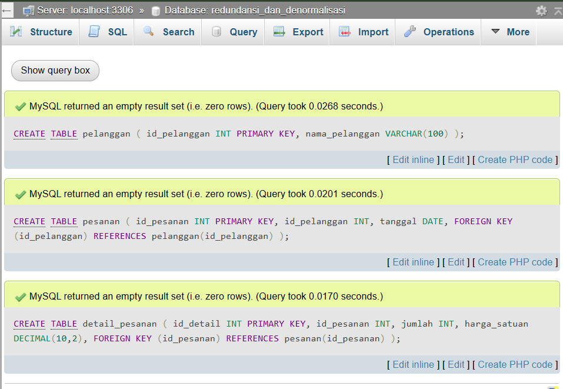

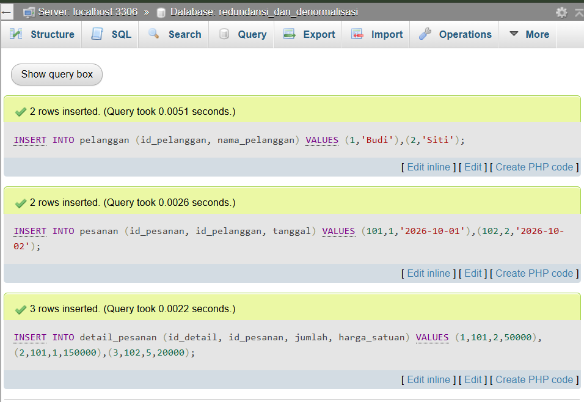

## Relasi Tabel
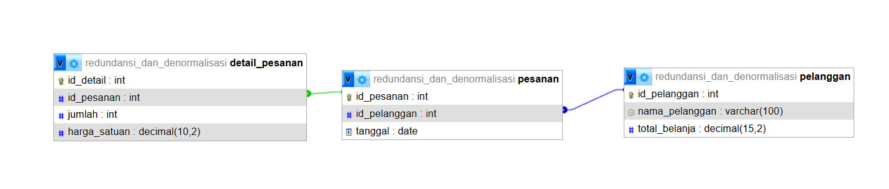

Gambar diambil setelah Tahap 2, sehingga kolom `total_belanja` sudah ada di tabel `pelanggan`.

## Tahap 1 - Eksplorasi JOIN (Kondisi Normalisasi)
Query `LEFT JOIN` + `SUM` + `GROUP BY` untuk menghitung total belanja per pelanggan.

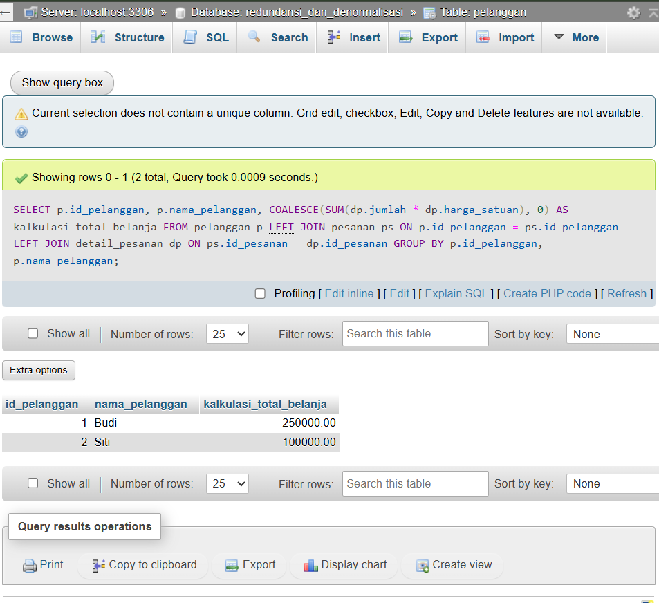

Hasil: Budi 250000, Siti 100000.

## Tahap 2 - Penerapan Denormalisasi
Menambah atribut turunan `total_belanja` pada tabel `pelanggan`, lalu mengisinya
dari hasil perhitungan Tahap 1.

DDL `ALTER TABLE`:

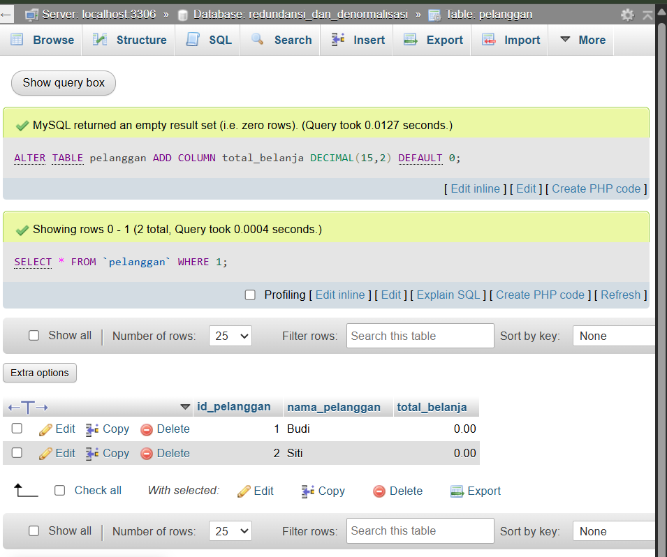

Mengisi kolom dengan `UPDATE` (2 baris berubah):

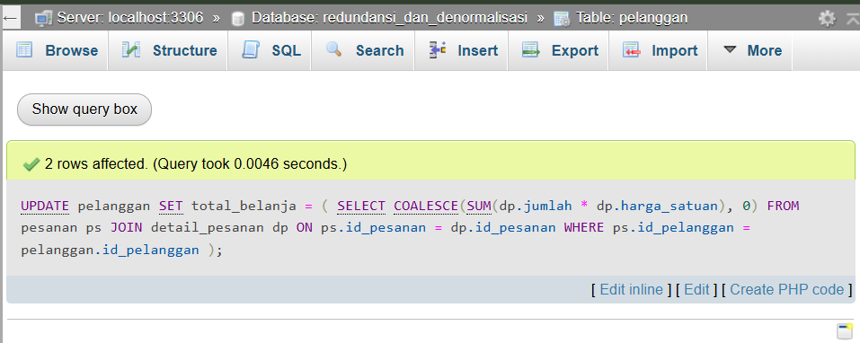

## Tahap 3 - Pembuktian
`SELECT` sederhana dari satu tabel, tanpa JOIN dan tanpa agregasi.

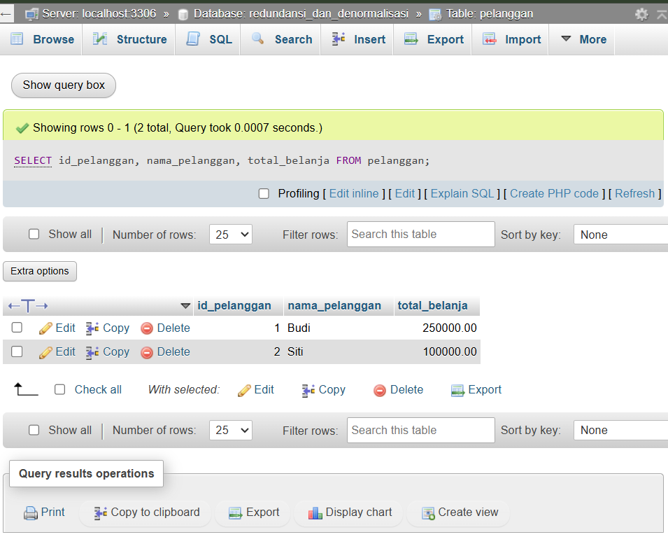

### Perbandingan Kompleksitas Query
| Aspek | Tahap 1 (Normalisasi) | Tahap 3 (Denormalisasi) |
|---|---|---|
| Tabel yang diakses | 3 (`pelanggan`, `pesanan`, `detail_pesanan`) | 1 (`pelanggan`) |
| Jumlah JOIN | 2 (LEFT JOIN) | 0 |
| Fungsi agregat | `SUM` + `GROUP BY` | Tidak ada |
| Pekerjaan database | Menghitung ulang setiap dijalankan | Hanya membaca nilai tersimpan |
| Hasil | Budi 250000, Siti 100000 | Sama dengan Tahap 1 |

## Pengujian Lanjutan: Data Besar, Trigger, dan Konsistensi
Redundansi: nilai `total_belanja` bisa dihitung dari `detail_pesanan`, tetapi sengaja
disimpan lagi supaya pembacaan lebih ringan. Akibatnya informasi yang sama ada di dua
tempat dan bisa tidak sinkron.

**1. Data besar dimasukkan** (10.000 pelanggan, 50.000 pesanan, 100.000 detail pesanan)

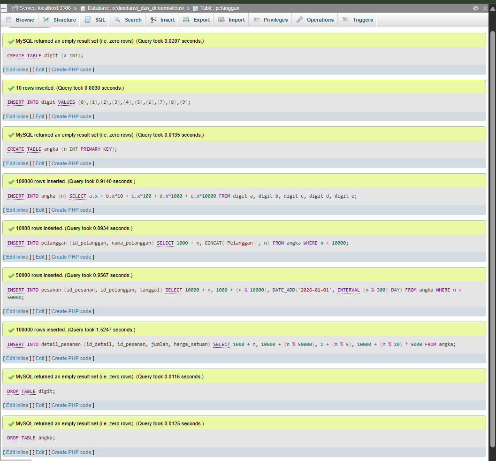

**2. Detail pesanan baru untuk Budi dimasukkan** (belum ada trigger)

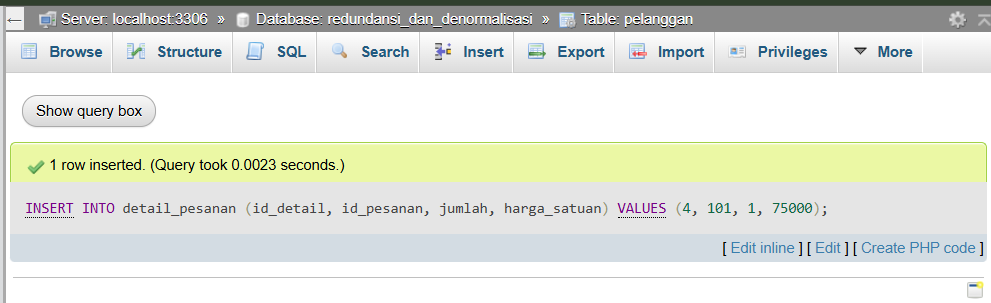

**3. Trigger dibuat** (`trg_detail_after_insert`, hanya untuk INSERT)

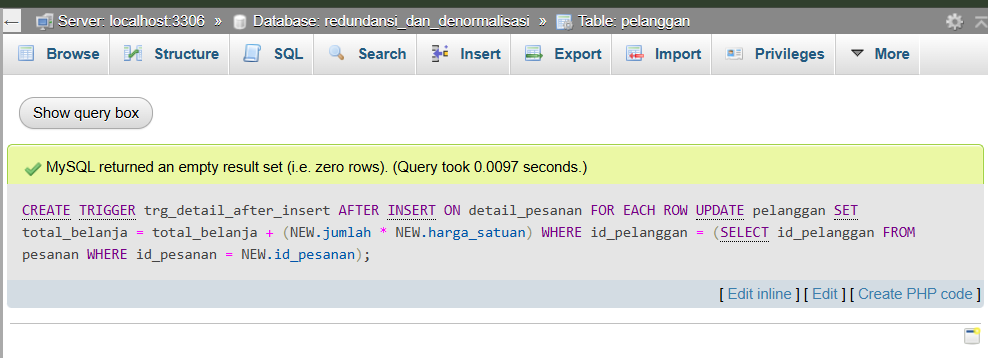

**4. Tes trigger:** detail baru untuk Siti masuk, `total_belanja` naik otomatis menjadi 110000

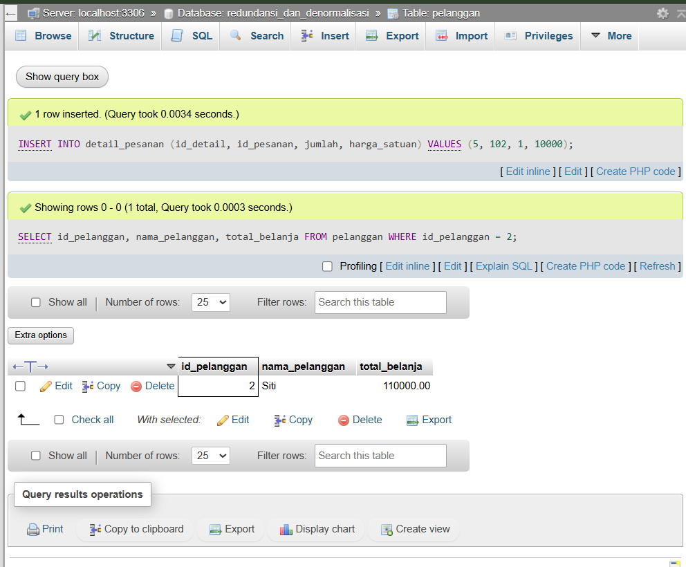

**5. Cek konsistensi:** 10.001 baris tidak sinkron

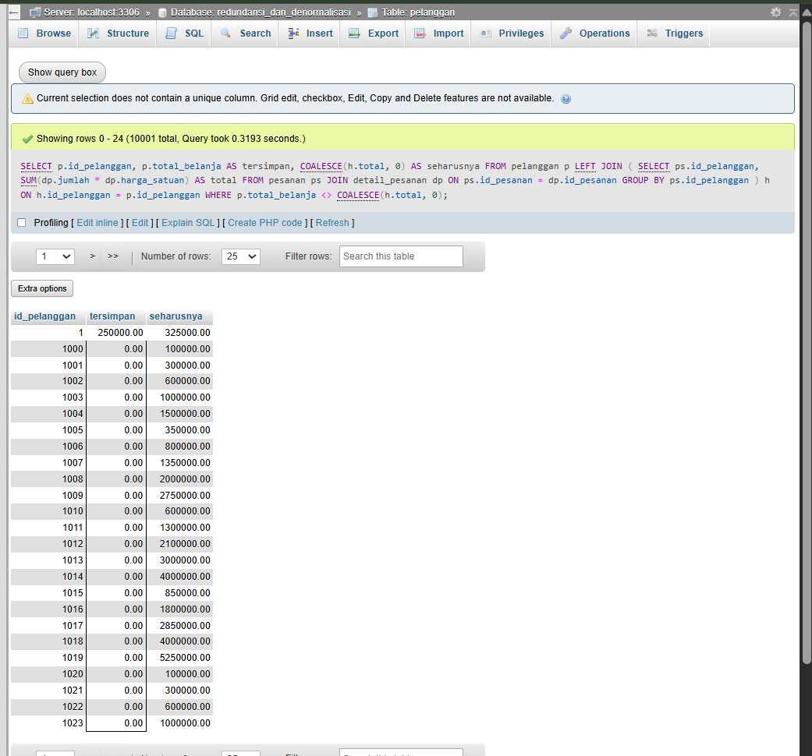

Budi tersimpan 250000 padahal seharusnya 325000, karena pesanan barunya masuk sebelum
trigger dipasang. Sebanyak 10.000 pelanggan dari data besar juga masih bernilai 0.
Siti tidak ikut daftar karena sudah dijaga trigger.

**6. Sinkronisasi ulang dengan `UPDATE`** (10.001 baris berubah)

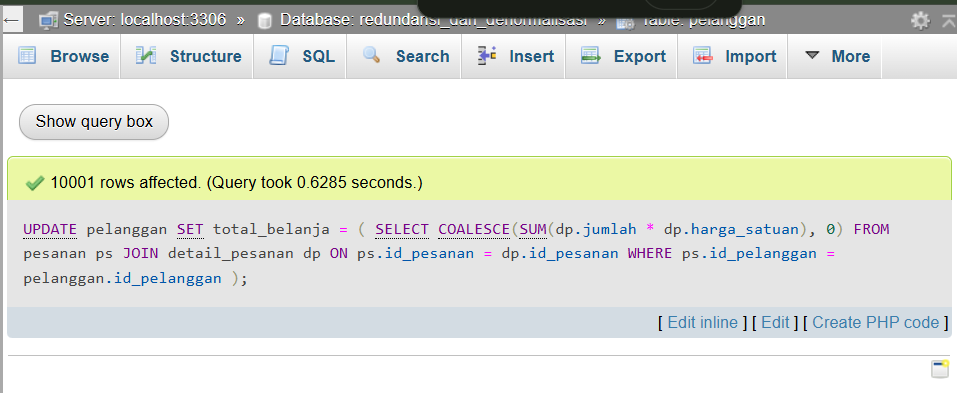

**7. Cek ulang:** hasil kosong (0 baris), semua nilai sudah sinkron

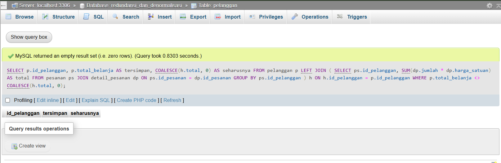

## Kesimpulan
Denormalisasi membuat pembacaan lebih sederhana karena tidak perlu JOIN dan agregasi,
tetapi menambah redundansi sehingga data harus dijaga tetap sinkron. Trigger yang
dipakai baru menangani INSERT. Untuk perubahan dan penghapusan detail pesanan
diperlukan trigger tersendiri.
